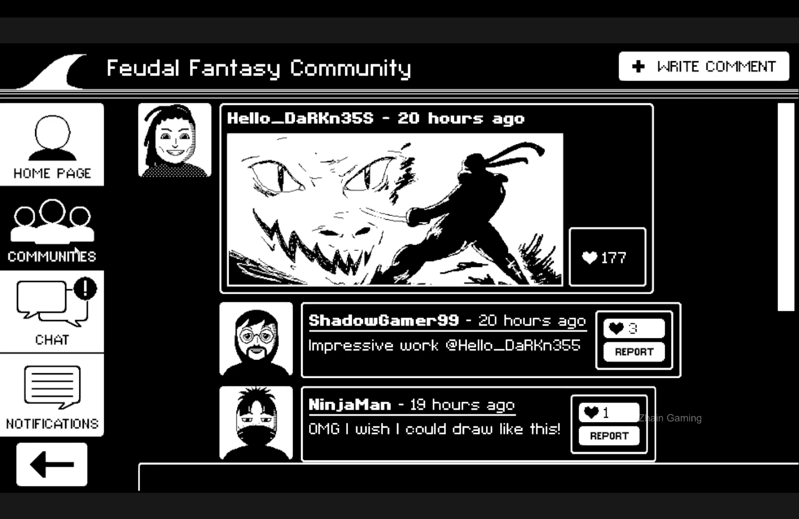
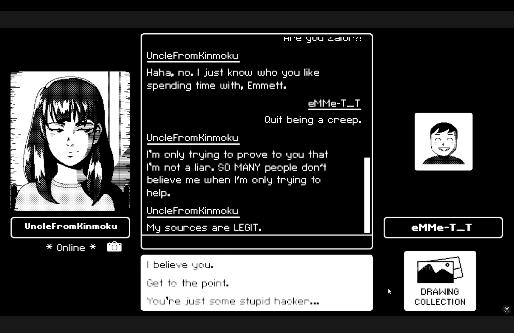
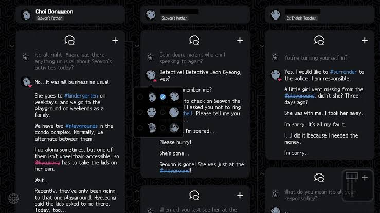
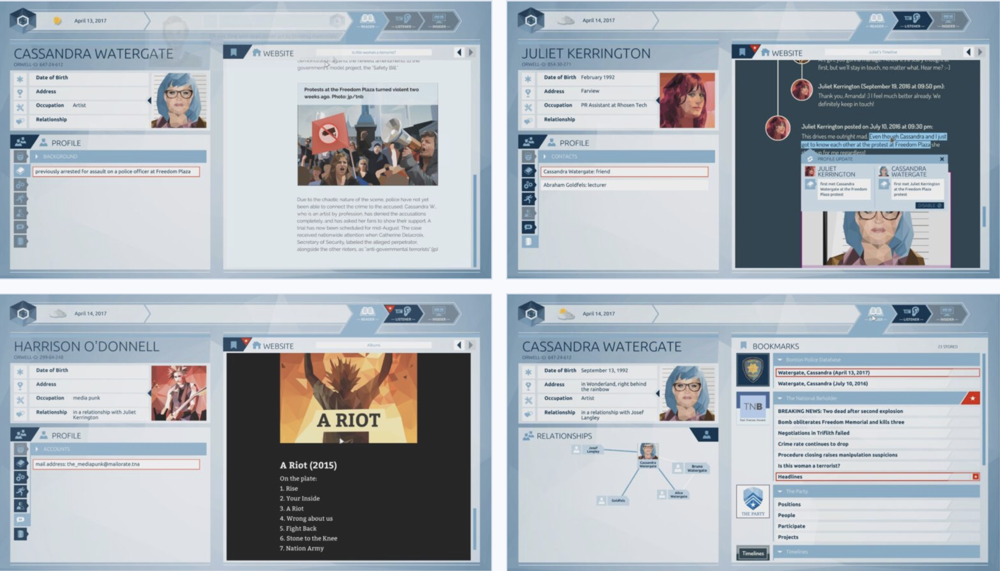
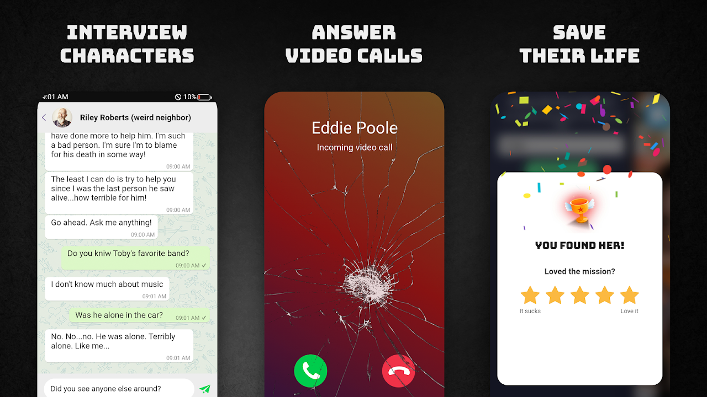

# /LAST MESSAGE LEFT/ Investigating an Internet Community

## 1/ Pitch
Play as Detective Marlowe, exploring an online community where friendships, rumours and conflicts intertwine, reconstructing conversations and deciding how to respond to cyberbullying without causing further harm.

## 2/ Plot
Invited to help an online community facing growing reports of cyberbullying, you discover a space where teenagers share creative work, discuss their interests and build friendships. Alongside these everyday exchanges, members experience exclusion, impersonation, public humiliation and the circulation of private messages without consent.

Rather than following a single victim or searching for one culprit, you investigate several interconnected stories. By examining voluntarily shared screenshots, exploring public threads and speaking with members, you reconstruct how conflicts develop, how accusations circulate and how other people’s reactions influence the situation.

As new conversations unfold, your initial interpretations are challenged. Someone targeted in one discussion may participate in another person’s exclusion, while a seemingly supportive response may unintentionally spread harmful content further.

Your decisions influence trust, what members choose to share and how the community responds. The investigation challenges you to recognise patterns of harm and deciding when to offer support, protect privacy or involve moderators.

## 3/ Moodboard

## 4/ Game mechanics
/Explore/ browse community posts, profiles and conversations to understand its interests and relationships

/Reconstruct/ organise message fragments, identify speakers and establish the chronology of exchanges

/Compare/ examine different accounts and distinguish confirmed information from interpretations and missing context

/Reflect/ internal voices of empathy, suspicion, logic and social pressure offer competing readings of the evidence

/Respond/ choose how to approach members and whether to offer support, seek clarification or involve moderators

/Observe/ return to the community to see how relationships and conversations evolve after your interventions

## 5/ Influences
### No Case Should Remain Unsolved
- Chronology Reconstruction (re-ogarnise dialogues, who’s speaking)
- Keywords, hashtags associations (memory stimulation, bring new memories)
- Key System (resolve correct sequences and questions to gain keys, it unlock major clues)

### Orwell
- Explore websites, messages and personal files to collect information
- Choose which information fragments to add to a person’s profile 
- Submitted information unlocks  different endings based on 

### Peek A Phone
- Phone exploration (navigate a simulated smartphone and examine messages, photographs and applications)
- Clue-based puzzles (use information found across the phone to unlock access and advance the investigation)
